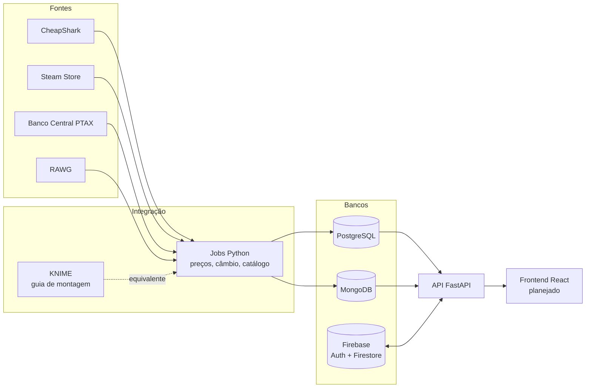

# WaitOrBuy

**Não compre só barato. Compre na hora certa.**

Compara o preço de um jogo de PC em várias lojas, em reais, guarda o histórico e responde à pergunta que o preço de hoje não responde: *vale esperar?*


## Índice

- [O problema e a solução](#o-problema-e-a-solução)
- [Funcionalidades](#funcionalidades)
- [Arquitetura](#arquitetura)
- [Stack e fontes de dados](#stack-e-fontes-de-dados)
- [Como rodar](#como-rodar)
- [Variáveis de ambiente](#variáveis-de-ambiente)
- [Testes](#testes)
- [KNIME](#knime)
- [Honestidade dos dados](#honestidade-dos-dados)
- [Estrutura de pastas](#estrutura-de-pastas)
- [Roadmap](#roadmap)

## O problema e a solução

O mesmo jogo tem preços diferentes em cada loja, as promoções aparecem e somem rápido, e é difícil saber se um desconto é bom ou se o jogo costuma ficar ainda mais barato depois.

O WaitOrBuy integra dados de várias fontes (preços, câmbio e catálogo) em uma visão única: lojas ordenadas do menor ao maior preço em reais, histórico por loja e um veredito explicado sobre o melhor momento de comprar.

## Funcionalidades

- **Busca por nome** com as lojas ordenadas do menor ao maior preço, em reais (`GET /api/search`).
- **Histórico de preços** por loja ou pelo melhor preço diário, com menor preço registrado e média (`GET /api/games/{id}/history`).
- **Indicador "vale esperar?"**: compara o preço atual com o histórico e com as próximas liquidações sazonais. Devolve veredito (`COMPRAR_AGORA`, `ESPERAR`, `NEUTRO` ou `INSUFICIENTE`), confiança e os motivos.
- **Preço por hora de jogo**: preço da melhor oferta dividido pelo tempo médio de jogo.
- **Alerta de preço**: o usuário define um preço-alvo; ao atingi-lo, recebe uma notificação.
- **Custo total da wishlist por loja**: mostra em qual loja o carrinho inteiro sai mais barato (`GET /api/me/wishlist/cart`, rota autenticada).

Contas, wishlist, alertas e notificações usam Firebase (Auth e Firestore).

## Arquitetura



| Banco | Por quê |
|---|---|
| PostgreSQL | Preços e câmbio são dados relacionais e séries temporais; a chave única (jogo, loja, dia) garante cargas idempotentes. |
| MongoDB | O catálogo (capa, gêneros, plataformas, nota) tem formato flexível, melhor como documento. |
| Firebase | Autenticação e dados por usuário (wishlist, alertas, notificações), com emulador local para desenvolvimento. |

## Stack e fontes de dados

**Stack:** Python 3.12, FastAPI, psycopg 3, PyMongo, firebase-admin, pytest, ruff, Docker Compose.

| Fonte | O que fornece | Chave |
|---|---|---|
| [CheapShark](https://www.cheapshark.com/api) | Ofertas e preços (USD) em várias lojas de PC | Não |
| Steam Store | Preço em reais (`cc=br`) | Não |
| [RAWG](https://rawg.io/apidocs) | Capa, gêneros, nota, tempo médio de jogo | Sim (gratuita) |
| Banco Central (PTAX) | Cotação do dólar para converter USD em BRL | Não |

Notas sobre o comportamento observado de cada API estão em [docs/API_NOTES.md](docs/API_NOTES.md).

## Como rodar

**Pré-requisitos:** Docker com Docker Compose e `make`.

```bash
cp .env.example .env     # ajuste se necessário; a chave da RAWG é opcional
make up                  # sobe Postgres, Mongo, emulador Firebase, API e ETL
make migrate             # cria as tabelas
make etl                 # busca preços, câmbio e catálogo
make seed-demo           # (opcional) histórico simulado para demonstração
```

Outros comandos do Makefile: `make down`, `make reset` (apaga os volumes), `make logs`, `make alerts-eval` (avalia os alertas), `make lint`, `make test` e `make verify` (lint + testes).

| Serviço | URL |
|---|---|
| API | http://localhost:8000 |
| Documentação interativa (Swagger) | http://localhost:8000/docs |
| Health check | http://localhost:8000/health |
| PostgreSQL / MongoDB | `localhost:5432` / `localhost:27017` |
| Emulador Firestore / Auth | `localhost:8080` / `localhost:9099` |

Não há usuário de demonstração pré-cadastrado: as rotas de usuário exigem um token do emulador do Firebase Auth. Os formatos de requisição e resposta estão em [docs/CONTRACTS.md](docs/CONTRACTS.md).

## Variáveis de ambiente

Definidas em [.env.example](.env.example). Dentro do Compose, os hosts são os nomes dos serviços.

| Variável | Descrição |
|---|---|
| `POSTGRES_USER`, `POSTGRES_PASSWORD`, `POSTGRES_DB` | Credenciais do PostgreSQL |
| `DATABASE_URL` | String de conexão do PostgreSQL |
| `MONGO_URL`, `MONGO_DB` | Conexão e nome do banco MongoDB |
| `RAWG_API_KEY` | Chave da RAWG; vazia, o catálogo usa dados editoriais marcados como fixture |
| `ETL_INTERVAL_HOURS` | Intervalo entre execuções do ETL agendado |
| `ETL_PAUSE_SECONDS` | Pausa entre chamadas às APIs externas |
| `ETL_USER_AGENT` | User-Agent enviado às APIs (a CheapShark o exige) |
| `ADMIN_TOKEN` | Token do endpoint interno de avaliação de alertas; troque o valor padrão |
| `AFFILIATE_TAG` | Tag de afiliado (opcional) |
| `FRONTEND_ORIGIN` | Origem permitida pelo CORS |
| `BACKEND_URL` | URL da API vista pelo ETL |
| `FIREBASE_PROJECT_ID` | Projeto Firebase (`demo-waitorbuy` no emulador) |
| `FIRESTORE_EMULATOR_HOST`, `FIREBASE_AUTH_EMULATOR_HOST` | Endereços dos emuladores |
| `FIREBASE_CREDENTIALS` | Caminho do JSON da conta de serviço (opcional; habilita push FCM real) |

## Testes

```bash
make verify   # ruff + pytest, dentro do contêiner da API
```

A suíte fica em [tests/](tests/) e cobre a regra "vale esperar?", conversão e preço por hora, endpoints da API e a integração do ETL (incluindo idempotência). Os testes rodam no contêiner, com os bancos do Compose no ar.

## KNIME

O guia [knime/BUILD_GUIDE.md](knime/BUILD_GUIDE.md) descreve, nó a nó, três workflows: preços, câmbio PTAX e catálogo RAWG para MongoDB.

- **Pronto:** o guia, e os jobs Python equivalentes (`python -m etl.jobs.<job>`), que fazem o mesmo trabalho e são o que roda no Compose.
- **Manual:** montar os workflows na interface do KNIME e exportá-los. Os arquivos `.knwf` ainda não estão no repositório.

## Honestidade dos dados

- Preços de lojas obtidos em dólar são **estimativas**: convertidos pela cotação PTAX mais recente, podem diferir do valor cobrado em reais. Só os preços da Steam vêm direto em reais.
- O **histórico inicial pode ser simulado**: o histórico real só se acumula com o tempo, e `make seed-demo` gera linhas simuladas para a demonstração, sem sobrescrever dado real. A API sinaliza quando há histórico simulado (`has_simulated_history`).
- Sem `RAWG_API_KEY`, gêneros e tempo de jogo vêm de estimativas editoriais ([etl/tracked_games.yml](etl/tracked_games.yml)), marcadas como fixture. A integração com a RAWG não foi verificada com chave real.
- O calendário de liquidações sazonais é uma tabela interna e deve ser conferido com as datas oficiais.

## Estrutura de pastas

```
backend/    API FastAPI (rotas, serviços, autenticação Firebase)
etl/        Jobs de integração: clientes das APIs, preços, câmbio, catálogo, seed
db/         Migrações do PostgreSQL
firebase/   Emulador (Auth e Firestore) e regras de segurança
knime/      Guia de montagem dos workflows
tests/      Testes unitários, de API e de integração do ETL
docs/       Briefing, contratos de dados e notas das APIs
```

## Roadmap

Ainda não implementado:

- Frontend em React (busca, página do jogo com gráfico de histórico, wishlist, alertas e notificações). Hoje o projeto expõe apenas a API.
- Workflows KNIME exportados (`.knwf`).
- Suporte a consoles.
