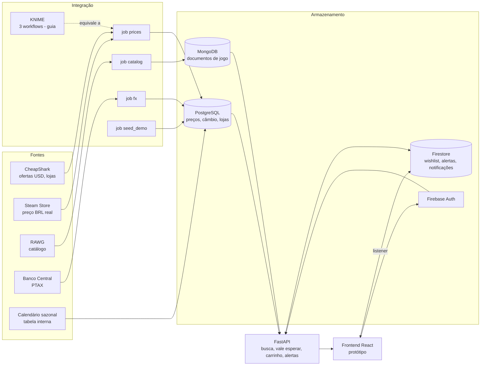

# Arquitetura

Fluxo de preços: `etl-runner` executa `fx → prices → catalog` a cada `ETL_INTERVAL_HOURS`, depois chama `POST /api/admin/alerts/evaluate`; a avaliação lê o menor preço atual no PostgreSQL e grava notificações no Firestore; o frontend as recebe pelo listener do Firestore.

## Por que cada banco
- **PostgreSQL** — dados relacionais e série temporal de preços: `UNIQUE(jogo, loja, dia)` garante idempotência, agregações (mínimo, média 90 dias) e views (`v_latest_price`, `v_price_stats`) são naturais em SQL.
- **MongoDB** — metadados de jogo são documentos de formato variável (gêneros, plataformas, descrição) que mudam conforme a fonte (RAWG vs. fixture); schema flexível, leitura por `game_id`.
- **Firestore + Auth** — dados por usuário com regras de segurança por documento, listener em tempo real para notificações e identidade pronta (Auth), sem montar login do zero.

## Decisões relevantes
- Steam grava BRL real; a linha convertida da CheapShark para a Steam é descartada (os preços diferem muito).
- Conversão usa a cotação de **venda** PTAX; fim de semana/feriado usa a última cotação anterior.
- "Vale esperar?" é determinístico, com limiares em um só lugar (`backend/app/config.py`) e motivos em pt-BR com números reais.
- Alertas rearmam quando o preço volta acima do alvo (sem spam).
- O cliente HTTP do ETL respeita `Retry-After` longo da CheapShark (bloqueio por IP) parando o ciclo e retomando no próximo.
- Proteções: CORS restrito à origem do frontend, SQL sempre parametrizado, validação pydantic, rate limit por IP (em memória, 1 processo), token admin comparado em tempo constante.
